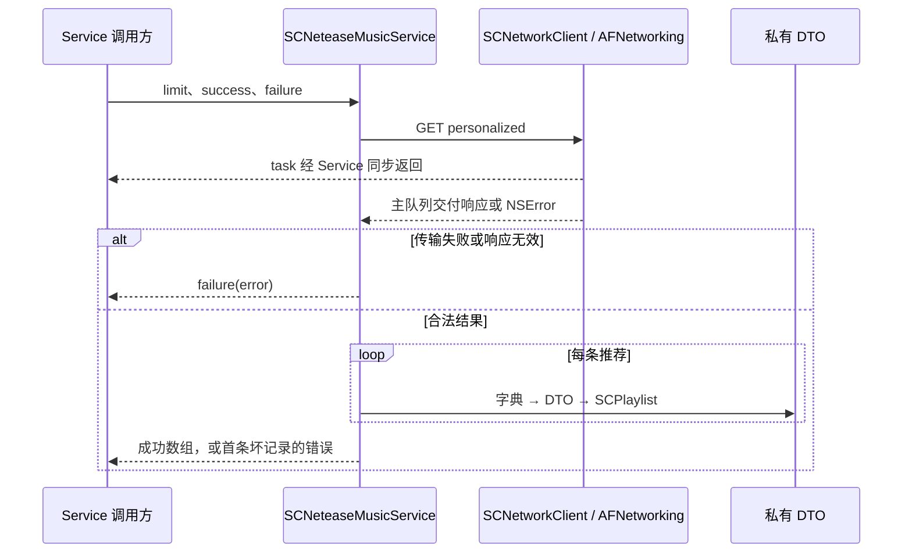

# Task 4 · 把公共推荐响应转换为首页歌单

> 阶段记录：下文按当时的实现讲解。Task 6 已将正式首页切换到 SCRemoteHomeProvider，并完成真实封面、下拉刷新、分区状态和联网验收。[当前首页实现与验证](05-HomeRemoteIntegration.md)


## 目标与改动

本阶段的交付边界是 Service 的成功回调。它返回有序的 `NSArray<SCPlaylist *> *`。当前首页仍由本地 Provider 从音乐目录加载分区。

| 文件 | 本阶段的变化 |
|---|---|
| Spotify/Common/Services/SCNeteaseMusicService.h、.m | 对齐已有类型声明与实际元素，补全私有 DTO、字段校验和转换，区分失败与空结果 |
| Spotify/Core/Network/SCNetworkClient.h、.m | 按项目格式整理，显式声明响应类型转换辅助方法的可空签名 |
| Tests/Music/SCRecommendedPlaylistTests.m、run-tests.sh | 独立进程用本地响应替换传输，运行实际 Service、YYModel 和领域模型 |
| SpotifyClone_Development_Roadmap.md | 更新阶段进度、开发方式和下游验收点 |

## 真实接口契约

| 样本字段 | 领域属性 | 缺失、类型与精度策略 |
|---|---|---|
| id，整数 17660040122 | identifier | 必需。保留 Foundation 数字对象的精度，取十进制字符串。拒绝布尔、非正数、二进制浮点数及字符串。十进制数对象须能表示为纯数字字符串。 |
| name，字符串 | title | 必需。校验原始类型，去掉首尾空白，结果须非空。 |
| trackCount，整数 275 | 无 | 可缺失，忽略。tracks 表示已经拿到的歌曲对象，初始值为空数组。 |
| playCount，整数 65266 | 无 | 可缺失，当前首页没有使用这个计数。 |
| 样本未提供封面、创建者和副标题 | artworkName、creatorName、subtitle | 使用资源 SCCover00 和领域模型初始化的两个空字符串。 |
| 样本未提供收藏状态 | saved | 保留 SCLibraryStore 根据 identifier 查询到的本地状态。 |

样本的字段范围以仓库保存版本为准。Task 5 已为可选 picUrl 增加独立 artworkURL 属性，并用受控样本验证。卡片继续使用本地资源名，实际远端图片展示待首页接入验收。[响应样本](../api/samples/home.json) · [领域模型](../../Spotify/Common/Models/SCPlaylist.m)

## 源码与运行原理

`fetchRecommendedPlaylistWithLimit:success:failure:` 把 limit 放进请求参数，向 NetworkClient 请求 personalized，返回可空 NSURLSessionTask。响应根对象、业务码和 result 结构通过检查后，逐项执行以下两个操作。

```objc
[SCRecommendedPlaylistDTO yy_modelWithDictionary:row]
[dto playlist]
```

第一个方法将字典转为接口专用对象，可以返回 nil。第二个方法创建首页使用的 SCPlaylist，执行实际的领域映射。两个对象的生命周期分开，领域模型也可由本地音乐目录构造。[Service 实现](../../Spotify/Common/Services/SCNeteaseMusicService.m)

1. YYClassInfo 通过 Objective-C Runtime 枚举属性，从属性编码与访问器中取得类型、getter 和 setter。YYModel 缓存每个类的映射元数据，数组中多条歌单可以复用同一份描述。
2. `modelCustomPropertyMapper` 返回属性名到 JSON 键的对应关系。这里 playlistID 取 id，title 取 name。库根据目标类型选择转换路径，通过相应签名的 setter 消息赋值。对象类型 NSNumber 能保留已解码整数；若属性声明成 int，赋值时就有截断风险。
3. YYModel 能做宽松转换，例如把数字转换为字符串。赋值后调用的 `modelCustomTransformFromDictionary:` 仍收到原始字典，所以能够拒绝数值型名称。缺键得到 nil，显式 JSON null 得到 NSNull，两者都无法通过必需类型检查。返回 NO 会使本次模型创建失败。
4. JSON true 在 Foundation 中也是 NSNumber 家族对象。通过 CFBoolean 的类型 ID 排除它。数值 9007199254740993 若经过 double 会丢失个位；转换直接取已校验 NSNumber 的 stringValue。这个保证从 Foundation 解码结果开始，服务端若已舍入，客户端无法恢复原始数字。
5. 批量 API `yy_modelArrayWithClass:json:` 会忽略非字典或转换失败的行。现有 Service 采用整批失败语义，因此逐条转换，错误包含首条坏记录的下标。代价是单条异常会使整组推荐暂不可用。合法空 result 会返回空数组。此端点没有需要建模的嵌套容器属性。

可从本地依赖的 YYClassInfo、模型元数据构建、yy_modelWithDictionary: 和 NSArray 分类顺着调用阅读。[Runtime 元信息](../../Spotify/Pods/YYModel/YYModel/YYClassInfo.m) · [YYModel 映射实现](../../Spotify/Pods/YYModel/YYModel/NSObject+YYModel.m)

## 架构、回调与对象持有



AFHTTPSessionManager 复用 NSURLSession，AFJSONResponseSerializer 解码响应。dispatch_once 保证同一个 manager 的初始化只执行一次，初始化之后不再改动它的序列化器与队列。它不会自动保护其他可变状态。完成队列设为主队列，所以 Service 的小批量转换也在主队列。若以后数据量增长，应先测量转换耗时，再考虑后台映射与回主队列交付。[网络层实现](../../Spotify/Core/Network/SCNetworkClient.m)

请求执行期间，回调 Block 持有捕获的上层 Block。Service 没有将回调保存在实例中，这条链没有自持有闭环。每次响应使用独立的可变数组，数组持有领域模型，交付时复制为不可变数组；DTO 仅在转换期间使用。Task 5 已实现分区组织，正式首页将在 Task 6 切换 Provider。此阶段没有 UI 刷新。

直接在 SCPlaylist 上做 YYModel 映射可以少一个私有类，但公共模型就需要认识网易云字段，并限制传入字段触发的 setter。例如 setSaved: 会写入本地收藏。私有 DTO 只声明本端点需要的属性，其 playlist 方法承担 Mapper 职责。代价是新增接口字段时需要显式选择是否进入领域模型。

## 常见错误与自测

- 只检查 HTTP 200 会把业务拒绝当成数据；只检查业务码又会漏掉 result 为 null 的错误。先检查响应结构，再读业务码和数组。
- 强转数组类型仅影响编译器，字典并不会变成 SCPlaylist。应在成功回调前完成实例构造。
- 构建时若 YYModel 的协议方法报告空值冲突，应对齐项目所用版本的协议声明。modelCustomPropertyMapper 允许返回 nil。
- 从仓库根目录运行 `bash Tests/Music/run-tests.sh`。测试替换 NetworkClient 的 HTTP 边界，检查真实样本、超过 double 精确整数范围的 ID、排序、空结果、非法行、一次回调及原始网络错误。同步测试替身不验证真实网络时序，实际联网留给首页接入。
- 自测题：第二条记录缺少 name 时，第一条会被交付吗？为什么 275 首歌对应的 tracks 仍为空？若回调中写入 saved = NO 会影响哪个对象？答案分别见逐项校验、样本字段表和领域模型的收藏 setter。

## 面试题与项目价值

| 问题 | 原理与项目回答 | 可继续追问 |
|---|---|---|
| YYModel 怎样知道给哪个属性赋值？ | Runtime 提供属性类型和访问器，缓存的元数据将 JSON 键关联到 setter。项目显式将 name 对应到 title，再用原字典校验类型。 | 如果未来接口把名称改成数字，怎样防止静默接受？ |
| 64 位设备上为什么 ID 仍可能损坏？ | 设备位数不能改变 int 的宽度，也不能提高 double 的有效精度。本项目用 Foundation 解码真实整数，直接转十进制串，并测试 2^53+1。 | 服务端先把 ID 转成浮点数时，还能恢复吗？ |
| 为什么引入 DTO？ | SCPlaylist 同时服务于本地目录、收藏和 UI；私有 DTO 把供应商字段及其校验留在 Service，并限制领域 setter 的调用。 | 多个端点复用同一转换规则时，何时提取独立 Mapper？ |
| 怎么区分取消与空列表？ | 取消走传输失败回调，保留原 NSError；空列表来自成功业务响应，调用 success 并传空数组。 | 取消后如何防止迟到回调覆盖新请求的首页内容？ |

这项工作适合在面试中说明第三方数据与领域模型的边界，以及如何用反例验证精度和错误契约。可描述为“为推荐歌单建立类型化映射，用真实样本和边界输入覆盖大整数 ID、坏记录及空结果”。本阶段没有做耗时对比或吞吐测试，不作为性能优化成果。
