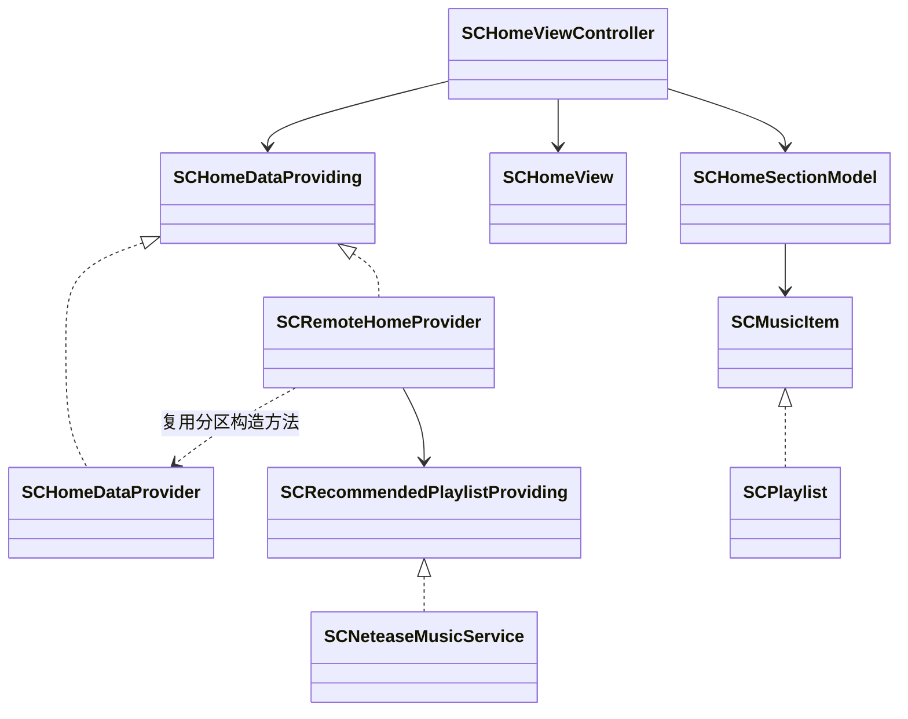
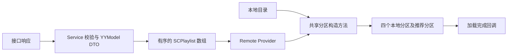
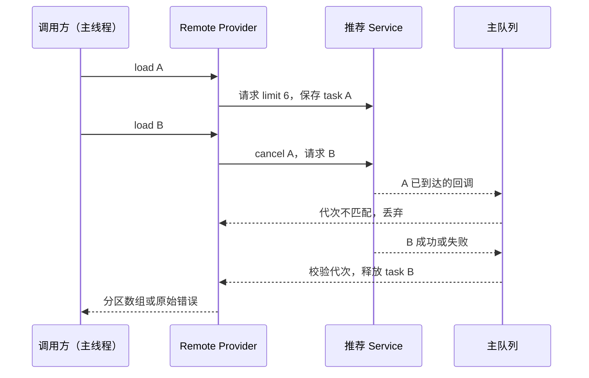

# Task 5 · 公共推荐如何进入首页分区

> 阶段记录：下文按当时的实现讲解。Task 6 已将正式首页切换到 SCRemoteHomeProvider，并完成真实封面、下拉刷新、分区状态和联网验收。[当前首页实现与验证](05-HomeRemoteIntegration.md)

## 开发目标与验收边界

交付一个可注入现有首页的 SCRemoteHomeProvider。一次请求取六条公共推荐，前四个分区沿用本地音乐目录。线上响应可以少于六条。正式入口仍创建 SCHomeDataProvider。Task 5 验证 Provider 输出，Task 6 才切换入口并验收屏幕状态。

## 文件与职责

| 文件 | 本阶段工作 |
|---|---|
| Spotify/Home/Data/SCRemoteHomeProvider.h、.m | 实现加载、取消、注入 Service、主队列交付、抑制过期结果 |
| Spotify/Home/Data/SCHomeDataProvider.h、.m | 声明可选取消能力，抽出两个 Provider 共用的分区构造方法 |
| Spotify/Common/Services/SCNeteaseMusicService.h、.m | 提取只含推荐方法的协议；在 DTO 映射阶段保留可选图片地址 |
| Spotify/Common/Models/SCPlaylist.h | 区分远端 artworkURL 与本地 artworkName |
| Spotify/Spotify.xcodeproj/project.pbxproj | 登记 Home/Data 新文件及实现文件的 target membership |
| Tests/Music/SCHomeProviderTests.m、SCRecommendedPlaylistTests.m、run-tests.sh | 新增可控 Service 测试，增加样本与真实 Service 到 Provider 的集成测试 |
| SpotifyClone_Development_Roadmap.md、docs/learning/03-YYModel.md、本文 | 记录验收与图片元数据变化 |

## 首页当前如何工作

SCMainTabBarController 创建 SCHomeViewController。其 init 使用本地 Provider 调用 initWithDataProvider:。控制器初始 sections 为空，在 viewDidLoad 中担任 collection view 的 dataSource 和 delegate，加载一次。成功时切到主队列，先更新控制器的 sections，再调用 SCHomeView.showSections:。View 保存布局使用的快照、reloadData 并使布局失效。控制器从同一批 section.items 获取具体对象，快捷项、歌曲和歌单/专辑分别进入不同 Cell。点击 SCPlaylist 时把原对象传入详情控制器。

首页的加载状态目前体现在空的初始数组、成功替换数组和失败 alert 三条路径。没有独立 loading 枚举或下拉刷新入口，失败提示仍使用 local preview 文案。首页头部筛选更新选中按钮，不会触发 Provider 请求。[首页控制器](../../Spotify/Home/ViewControllers/SCHomeViewController.m) · [布局与刷新](../../Spotify/Home/Views/SCHomeView.m)

### 类关系

### 数据流

## 关键源码与设计取舍

1. **入口与注入。** Remote 的 init 为正常使用选择 SCNeteaseMusicService；initWithService: 接受 id&lt;SCRecommendedPlaylistProviding&gt;，强持有它。构造完成即有可用依赖。属性注入允许后设或更换依赖，但这里会引入“请求发起时还没配置 Service”这一状态。单例解决共享实例问题；注入解决谁选择该实例，两者可以共存。NetworkClient 共享 Manager，测试则给 Provider 单独注入可控 Service。[构造器](../../Spotify/Home/Data/SCRemoteHomeProvider.m)
2. **数据组织。** sectionsWithRecommendedPlaylists: 接受领域对象，生成 Shortcuts、Made For You、Recently Played、Jump Back In、Recommended For Today。前四个分区来自同一目录，第五个的 items 来自参数。直接复用这段构造避免按显示标题查找替换，也无需先创建再丢弃本地推荐分区。Section 复制数组容器，元素仍是原来的歌单对象，精确 ID、标题和 URL 随对象传递。[共享构造方法](../../Spotify/Home/Data/SCHomeDataProvider.m)
3. **图片边界。** Phase 0 存档没有封面字段。本次用受控输入测试可选 picUrl：有主机的 HTTP(S) 地址写入 artworkURL，缺失或无效值保留 nil。卡片继续按 artworkName 取本地封面。字段在线上响应中的实际可用性留到 Task 6 确认。
4. **错误边界。** Service 处理业务码、异常行和 DTO；Provider 成功时组合分区，空列表仍产生含零项的第五区。失败时上交原 NSError 和空 sections。调用方可据此保留上次快照。Provider 不承担界面错误文案。Repository 通常按领域对象处理多来源检索或持久化策略；这里组合的是首页布局所需的数据。ViewModel 通常还暴露显示状态和展示值；现有 MVC 已由 VC 负责展示决策，无需额外状态对象。
5. **线程和生命周期。** load 与 cancel 从主线程调用。load 先取消上次任务，再记录 generation。Service 回调只负责排队，最终交付也在主队列执行；此时检查代次，可以识别“结果已排队、随后被取消”。有效回调先使代次失效、释放 task，再通知上层，允许 completion 内安全重入。即使注入的 Service 同步回调，也会等 load 设置 task 后再交付。新请求覆盖、显式取消、对象释放都抑制旧回调。dealloc 取消 task。Block 弱捕获 Provider，真正交付时暂时强持有；上层若持有 Provider，也应避免在 completion 中长期强捕获该 owner。

### 异步时序

## Objective-C 协议与 SOLID

id 表示动态对象引用，id&lt;协议&gt; 进一步限定编译器可见的消息集合。协议默认 required；本地 Provider 的同步加载没有进行中的请求，取消由 optional 声明。通过协议引用调用可选方法前检查 respondsToSelector:。conformsToProtocol: 查询声明的协议遵循关系，不能保证某个可选方法已实现。协议描述角色，类继承还提供实现和实例布局。轻量泛型与协议约束不会自动校验网络数据，运行时验证留在 Service。

| 原则 | 项目中的表现与边界 |
|---|---|
| SRP | Service 校验供应商响应，Provider 组织首页，VC 处理点击与导航，View 与 Cell 渲染。 |
| OCP | 增加 Remote 实现后，已有 VC 的数据源方法可以继续处理相同的分区模型。共享构造方法仍需随首页结构调整。 |
| LSP | 两种 Provider 都履行 sections/error 契约。调用方须允许同步或异步完成，并在主线程使用 Remote；不能依赖本地实现的立即回调。 |
| ISP | 推荐 Service 协议只有获取推荐的方法；取消是 Home 协议的可选能力，本地实现无需制造空任务。 |
| DIP | VC 接收抽象 Home Provider，Remote 的主要构造器接收抽象 Service；默认便利入口仍负责选择具体对象。 |

## 测试方法与常见错误

从仓库根目录执行 `bash Tests/Music/run-tests.sh`。可控 Service 保存每次请求的成功与失败 Block，返回真实但未启动的 URLSession task。测试可以控制顺序、从后台触发成功、复用旧 Block、取消后投递以及释放 Provider；直接依赖公网无法稳定重现这些时序。另一路在 HTTP 边界提供存档响应，让真实 Service 和 Remote 串起来处理样本及非法行。构建使用 Spotify workspace 的 Debug 模拟器目标。[Provider 测试](../../Tests/Music/SCHomeProviderTests.m) · [样本集成测试](../../Tests/Music/SCRecommendedPlaylistTests.m)

- 只调用 cancel 会漏掉已经入队的回调；必须在实际交付处核对请求身份。
- 直接清空当前 task 再判断代次，会让旧请求误清新任务；应先核对代次。
- 把失败转成六条本地推荐会掩盖网络错误；测试检查 NSError 对象身份和空 sections。
- 当前前四区使用本地目录的固定范围，与已有本地 Provider 共享目录规模假设。Task 6 需单独验收远端空分区的视觉处理及真实错误文案。

## 面试题与参考回答

| 面试题 | 结合本项目的回答 |
|---|---|
| 为什么在属性类型中写 id&lt;SCHomeDataProviding&gt;？ | VC 可以持有任一协议实现，编译时仍可检查 load 的声明。实现可以是同步本地目录或异步网络组合。 |
| 如何安全调用 optional 方法？ | 针对 cancelLoading 先判断 respondsToSelector:。声明遵循协议的本地 Provider 可以不实现可选取消。 |
| 构造器注入比可写 service 属性多保证了什么？ | 指定初始化器在第一次加载前就建立依赖，加载期间不会被公开属性换成另一个 Service。 |
| 为什么不让 VC 自己选择网络路径？ | VC 已负责 CollectionView 数据源和导航；把路径放入 VC 会让接口变动与 UI 同时变化。Task 6 可在创建 VC 的位置选择实现。 |
| 为什么取消后仍需要 generation？ | 取消不能撤回已入队的成功 Block。主队列在真正交付时比较 generation，才能保证旧响应无法覆盖新结果。 |
| weakSelf 与主队列分别解决什么？ | weakSelf 允许对象释放，主队列串行管理任务状态。弱引用本身无法判断哪个请求最新。 |
| 怎样验证失败没有伪装成空推荐？ | 模拟空成功应得到五区且无错误；模拟失败应得到零区且 NSError 与原对象相同。 |
| 如何证明 Provider 没损失模型字段？ | 断言传入歌单与输出 item 是同一对象，再用真实样本穿过 DTO 和 Provider 检查大整数 ID。 |
| Provider 是否等于 Repository 或 ViewModel？ | 此 Provider 输出首页分区并协调请求；持久化、一致性策略和按钮展示状态都不在这里，当前 MVC 能直接消费其契约。 |

## 自测与阶段价值

1. A 请求完成后已排入主队列，用户此时启动 B；哪个检查决定 A 能否交付？
2. 推荐为空时，为什么控制器不能只用 sections.count 判断推荐有无内容？
3. 如果明天把推荐卡片文案本地化，为什么当前组合方法仍能工作？
4. 为什么通过宿主机的离线测试仍需要进行 iOS target 构建和后续真机或模拟器联网验收？

本阶段可用于面试演示异步竞态的稳定复现，也可以说明如何在已有 MVC 中分区替换数据源。没有实施性能基准测试。
