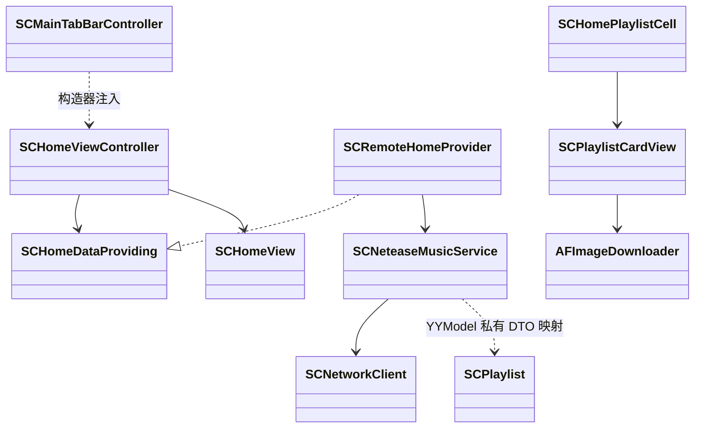
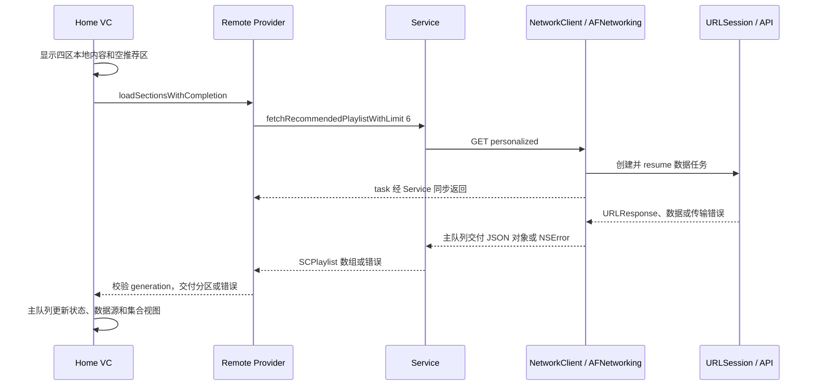
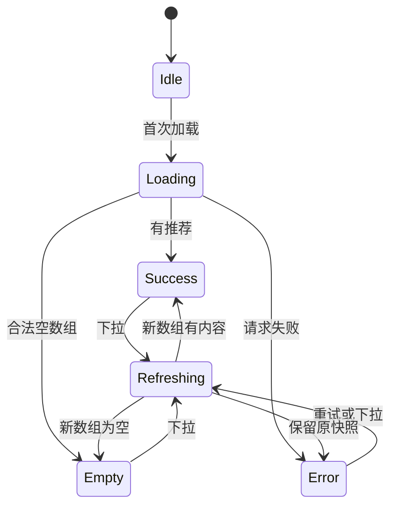

# Task 6 · 首页真实推荐、图片复用与刷新

## 目标与改动

正式首页通过构造器注入 SCRemoteHomeProvider。只有 Recommended For Today 使用公共推荐接口，其他四区沿用本地目录。Mock Provider 仍可通过相同构造器注入。

| 文件 | 对应改动 |
|---|---|
| Spotify/Common/ViewControllers/SCMainTabBarController.m | 创建首页时选择远端 Provider |
| Spotify/Home/ViewControllers/SCHomeViewController.m | 初始快照、请求入口、状态切换、重试和释放时取消 |
| Spotify/Home/Views/SCHomeView.m | 安装系统刷新控件，同步布局快照并选择刷新范围 |
| Spotify/Home/Views/SCHomeSectionHeaderView.h、.m | 在推荐标题下显示进度、空态、错误及 Retry，保留其他页面共用的单标题接口 |
| Spotify/Home/Views/SCHomePlaylistCell.m | 复用前取消当前封面订阅 |
| Spotify/Common/Views/SCPlaylistCardView.h、.m | 占位图、共享 AFImageDownloader、绑定身份检查与 JPEG MIME 兼容 |
| docs/qa/Task6-Home.png、本文、前两阶段文档、项目路线图 | 记录模拟器现场、阶段边界和验收结果 |

## 类关系与请求路径





请求方法返回时，调用方拿到的是可取消句柄。HTTPURLResponse 包含状态码和响应头；responseObject 是 AFJSONResponseSerializer 对响应体解码的 Foundation 对象。一次 HTTP 200 仍可能业务拒绝，业务码 200 也可能得到合法空数组。传输失败和 HTTP/解码错误经 NetworkClient 上报，业务错误由 Service 构造。本次在线观察读取已有 AFNetworking 完成通知，无需把供应商 JSON 暴露给 VC。

URLSession 异步执行 I/O。AFURLSessionManager 在处理队列做响应序列化，随后按 completionQueue 分发；本项目配置主队列，因此六条歌单的 YYModel 映射也在主线程。主队列把 UIKit 变更串行化，主线程 RunLoop 同时处理触摸与渲染，慢速同步工作会抢占其时间。若未来映射大批数据，应测量处理耗时，再考虑把映射移出主队列。图片由独立的 AF 图片下载器解码并在主队列投递，图片请求与推荐 JSON 分开。

## 状态与快照



loadRecommendations 是首次进入、UIRefreshControl 和 Retry 的共同入口。枚举让正在加载与正在刷新互斥；忙时收到第二次触发立即返回。取消错误恢复请求前状态。首次使用 sectionsWithRecommendedPlaylists:@[] 生成五个分区，本地四区可立即点击。刷新期间继续显示上次歌单，失败只更新标题提示。没有用 Mock 推荐填充错误或空结果。

Provider 对任务和 generation 的读写集中在主线程。取消无法撤回已入队的 Block；Provider 在真正交付处核对代次，VC 负责合并重复 UI 意图。VC 强持有 Provider，Provider 持有当前 task。完成 Block 和重试 Block 弱捕获 VC，在交付闭包内临时强持有，释放后不会再更新页面。对不可变绑定令牌或需交付的结果数组则需要强捕获，以覆盖异步生命周期。[状态与刷新实现](../../Spotify/Home/ViewControllers/SCHomeViewController.m)

## CollectionView 更新与图片绑定

控制器先替换 sections，随后 SCHomeView.showSections: 同步布局快照。初装或分区结构、前置分区内容变化时用 reloadData；分区数相同且前置内容一致，只 reloadSections: 最后的推荐区，并禁用此次刷新动画。失败路径只配置可见标题并使布局失效，保留已有 Cell。局部刷新仍会重新绑定可见推荐卡片；逐项差量更新可以减少绑定，但需要稳定的增删移动差异，本阶段六项快照无需引入 performBatchUpdates: 或 diffable data source。[布局快照](../../Spotify/Home/Views/SCHomeView.m)

```text
dequeue → configureWithItem → 取消旧 receipt → 显示本地占位图
   → 有 artworkURL → 生成本次绑定的 UUID → AFImageDownloader
   → 缓存命中或网络解码成功 → 主队列检查 UUID → 匹配才显示
prepareForReuse → 清除 UUID → 取消订阅；下一次配置重新设置占位图
```

每个绑定使用唯一令牌，同一个模型绑定两次也能区分。取消针对 receipt，同 URL 共享下载的其他订阅者可继续使用请求。即使图片来自缓存、没有返回 receipt，稍后抵达的成功回调也必须通过令牌检查。下载失败保留占位图。首次实测发现 CDN 的 JPEG 使用 image/jpg，HTTP 200 但默认图片序列化器报 -1016；仅给专用下载器增加这个 MIME 别名，保留状态码检查、解码与系统 TLS 校验。下载器复用现有 AF 内存缓存，无额外图片依赖。[卡片源码](../../Spotify/Common/Views/SCPlaylistCardView.m)

## 实际验收

2026-11-26，Spotify Debug，iPhone 17 Pro、iOS 26.3。模拟器运行已安装的项目，经已有登录开发入口进入正式 TabBar。临时验收探针观察 AF 完成通知、逐张滚动到 Cell、比较其 UIImage 与对应 URL 的解码对象，再触发首页的选择委托。探针未纳入产品。宿主机另一次 GET 也返回六项，内容与模拟器批次不同；下表全部来自修复后的同一次模拟器运行。

GET https://msapi.awup.cn/personalized?limit=6 返回 HTTP 200、业务 code 200、result 6 项；领域对象与推荐区均为 6 项。五区 item 数依次为 6、5、6、4、6。六张图片均来自 p2.music.126.net，显示对象全部与对应下载结果一致。

| 首屏推荐顺序 | 歌单 ID | 歌单名 |
|---|---|---|
| 1 | 18158497328 | 夜深了 该听歌了 |
| 2 | 6654730310 | 打游戏必备歌曲！ |
| 3 | 775041112 | 『纯音』夜，萤火虫和你 |
| 4 | 14060780125 | 深夜emo歌单「心碎」「遗憾」「孤独」 |
| 5 | 17845746427 | 热梗合集【大全纯净版】 |
| 6 | 17865206017 | 深夜emo伤感歌曲合集【适合晚上睡觉听】 |

首条图片路径为 /S1fy9BFD4MEpAp-u_CmZtQ==/109951173580304706.jpg。选择它后，详情模型与首页 item 对象相同，ID 仍为 18158497328。[模拟器首页截图](../qa/Task6-Home.png)

可控验证分两层。仓库的 bash Tests/Music/run-tests.sh 覆盖缺字段、错误类型、大整数、空数组、取消和迟到回调。模拟器在实际 Home VC 上注入可控 Provider，10 项检查通过：初始加载保留本地区、重复触发合并、超时保留本地内容、空推荐区的重试按钮可见、点击重试发出请求、合法空态、成功态、刷新保留快照并合并事件、HTTP 失败保留旧卡、取消恢复成功态。超时和 HTTP 失败为受控错误注入，未故意使外部服务失败。

## 常见问题与面试复盘

| 问题 | 结合实现回答 |
|---|---|
| 1. GET 返回 task 是否说明请求成功？ | 只说明获得任务句柄。网络、HTTP、反序列化和业务结果需要在异步回调中判断。 |
| 2. HTTP 200 为什么仍有失败？ | JSON 业务码可能拒绝，也可能是错误响应结构。图片实测还遇到过 HTTP 200 但 MIME 不在允许集合里。 |
| 3. JSON 和 YYModel 都在后台执行吗？ | AF 处理响应体后切回配置的完成队列；本项目的小批量 DTO 转换随后发生在主线程。 |
| 4. 为何把 UIKit 更新调度到主队列？ | 同一个串行执行环境协调用户事件、数据源与布局快照，避免界面读取半更新状态。 |
| 5. 首次加载与刷新为什么需要区别？ | 首次只有本地四区；刷新已有歌单时应保留快照并给出刷新状态，失败后仍可点击旧内容。 |
| 6. cancel 与 generation 各解决什么问题？ | cancel 减少无用工作；代次检查拒绝晚到结果，尤其是已经排入主队列的回调。 |
| 7. 为什么 prepareForReuse 之外还要在 configure 时取消？ | 原 Cell 可能直接重新绑定，且缓存回调不一定有可取消的 task，绑定令牌必须随配置更新。 |
| 8. 为什么不按 indexPath 判断图片归属？ | 刷新后同一位置可能代表另一个模型；每次绑定都有自己的令牌，同位置的旧回调也会失效。 |
| 9. weakSelf 与强引用各在何时使用？ | 逃逸 Block 弱持有 VC 或卡片，真正写 UI 时临时强持有。结果、令牌需跨异步边界存活，可强捕获。 |
| 10. reloadSections: 有哪些前提？ | 外层分区对应关系有效，数据源先更新。初装及其他分区有变化时退回全量刷新。 |
| 11. HTTP 失败时为何不回填 Mock？ | 用户看到的推荐身份必须可信；错误路径显示重试，旧快照仍可用，首次失败也不妨碍本地分区。 |
| 12. 为什么单独配置封面下载器？ | 只给图片解析器添加实测 CDN 类型，避免改变通用 JSON 网络客户端或者全局放开 MIME 校验。 |

自测：快速横向滚动后如何证明图片来自当前 URL？若取消旧任务晚于回调排队，分别由哪两层保护列表与卡片？空推荐时哪些 section 仍可打开？可分别从验收方法、Provider/绑定令牌和初始快照找到答案。

本阶段验证真实推荐列表、封面和详情入口的模型交付。真实详情元数据、歌曲列表和分页属于 Task 7。
