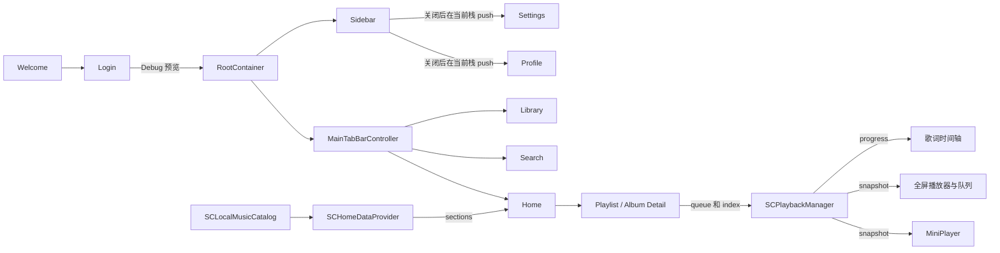
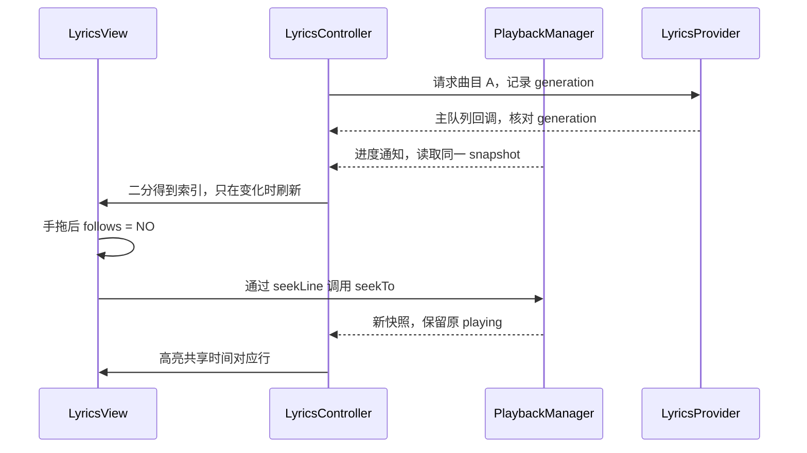
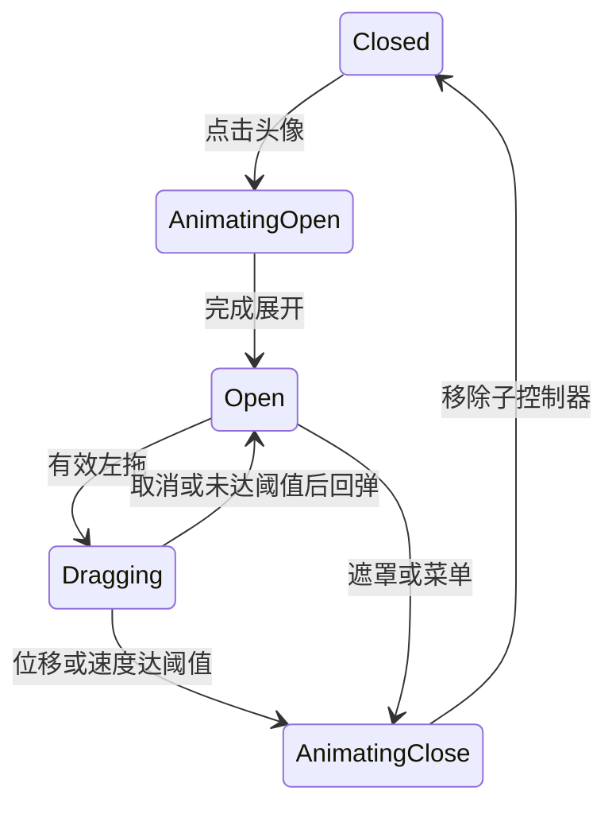

# 【iOS】Spotify 项目前端总结

学习范围为当前工作区的 Objective-C 客户端，包含 Phase 7.5 本地同步歌词。读这份总结时可以一直追问三件事：**谁拥有数据？一次用户动作经过哪些对象？页面关闭或结果晚到时谁还会收到更新？** 它们比记住按钮创建代码更能帮助你重建项目。

## 一、先校正原笔记里的几个判断

| 原笔记位置与说法 | 当前源码或机制 | 复习时要记住的差别 |
|---|---|---|
| 密码显隐：切换必然重置字体、移动光标，并禁止复制 | `SCAuthTextFieldView.togglePassword` 保存非空选区、切换 secureTextEntry、恢复选区。方法里没有赋值字体，也没有实现剪贴板策略 | 将「代码在防御选区变化」与「所有系统版本必然出现相同行为」分开。安全输入属性也不能充当完整的数据保护策略 |
| 离开登录页：主动擦除密码内存 | `viewWillDisappear:` 把模型与文本框的密码改为空串 | 能确认的是避免页面继续显示或持有原密码。ARC 释放引用与逐字节覆写是不同操作，不能由此证明所有字符串副本已清零 |
| 键盘适配完全交给系统 | Guide 更新可用空间；登录控制器仍监听键盘 frame 变化，View 再换算坐标并滚动 | 布局、第一响应者、可见区域是三个问题。Masonry 在这里构造约束，系统负责求解 |
| 六个输入框无法使用短信自动填充 | 当前实现让一个 UITextField 接收系统输入，六格显示它的投影 | 单输入源省去跨框分发；多输入框可以另行实现分发。系统出现建议也不等于应用读取短信 |
| Home 的协议保证异步回调 | `SCHomeDataProvider` 在调用栈内直接执行 completion；控制器另行 dispatch_async 到主队列 | Block 是一种可传递的调用方式。异步、并行、回调线程、回调次数都需要分别约定 |
| 正交滚动等于分页，并大幅节省内存 | 实际用 continuousGroupLeadingBoundary，停靠以布局 group 的起始边界为基准 | 可主张减少了手写嵌套与吸附逻辑；没有工程内 A/B 数据支持内存或 FPS 数字 |
| 控制器给五个按钮 addTarget 违反 MVC | 项目播放器本身就在控制器绑定按钮。歌单 header 用枚举和单个 block，隐藏控件细节 | 两种方式的差别在接口粒度和演进成本。暴露控件可能加大耦合，不能仅凭这一行判为违反 MVC |
| 创建按钮的辅助方法属于 GoF 工厂方法 | `buttonWithSymbol:label:action:` 在同一类内按参数创建和配置按钮 | 它集中构造逻辑。GoF Factory Method 的关键证据是通过可覆写创建步骤把具体产品选择交给子类，这里没有该结构 |
| 播放进度做了防抖，松手才 seek | `SCPlayerProgressView.setupUI` 明确设置 **continuous = YES**；ValueChanged 进入 seekTo:。render: 在 tracking 时只跳过反写 slider.value，时间文本仍更新 | 解决的是手指与状态回写争抢滑块。防抖需等待输入安静窗口，节流需限制调用频率，本段都没有做 |
| Mock 可以证明数千用例几秒完成 | Home 有注入接缝。仓库中可核对的 XCTest 是歌词测试，旧笔记的 MockProvider 属于可以编写的测试替身 | 区分可测试性、已有测试、实测耗时。可插入网络 Provider 也不意味着分页、取消和线程契约已经就绪 |

## 二、从启动链路读懂模块化 MVC

AppDelegate 返回 Scene 配置。SceneDelegate 创建 UIWindow，把包着 Welcome 的 UINavigationController 设为根；登录的 Debug 预览入口全屏呈现 SCRootContainerViewController。由它持有 SCMainTabBarController，Home、Search、Library 各自有导航栈。这样从 Library 进设置再返回，原栈、选中标签和唯一的 MiniPlayer 都能延续。iOS 26 分支使用 bottomAccessory，旧版本把 MiniPlayer 约束在 TabBar 上方并补底部安全区。



| 权威数据 | 谁写入、谁消费 | 生命周期与容易混淆的地方 |
|---|---|---|
| 本地音乐目录 | Catalog 组装歌曲、歌单、专辑、歌手。Home/Search/详情消费同一批对象 | 预览数据。Home 的 Recently Played 是本地专辑分区 |
| 播放队列、模式、索引、进度 | 只有 Manager 执行播放命令，各播放器视图读取 Snapshot | 内存中的模拟播放；AVPlayer、解码、缓冲尚未接入 |
| 收藏与最近时间 | LibraryStore 维护两个 ID 字典，并发送 SCLibraryDidChange | NSUserDefaults 本地持久化；记录最后一次时间无法表达同歌多次播放的事件序列 |
| 个人资料 | SCUser.current 接受保存后的昵称与头像，编辑器持有草稿 | 会话内存。Profile 的预览歌手与关注歌手各有来源，普通收藏也不自动成为公开歌单 |
| 设置值 | SettingsPreviewState 按 key 存取，Cell 只报告操作 | 会话内存。Crossfade、隐私与通知偏好尚无真实执行服务 |
| 歌词与阅读状态 | Provider 提供有序歌词，Timeline 从共享进度推导索引；View 保存 follows、translated | 手动阅读可以改变视口，只有 seek 动作改变播放时间 |

按业务分目录，让「修改注册邮箱如何使验证码失效」可以沿 Auth 内的 Model → Controller → View 查找。Service 处理跨页面规则，Store 保存事实，Provider 组织或读取数据。目录里有一个类并不等于它已投入使用：Common 的 SCAlbumCardView.m 和 SCArtistCardView.m 是空文件，实际详情货架复用 SCMusicItemCell。Podfile.lock 中的网络库也不能证明页面在发请求。

## 三、源码知识点索引

S 表示应能独立推导并口述，A 表示应能在另一页面复用，B 表示适合在特定问题出现时深入。下表中的实现均已在当前业务源码定位；独立扩展与未实现能力另列于文末。路径以仓库根目录为基准，行号对应本次工作区，不锁定 Git 提交。

| 优先级 | 模块 | 已实现的知识点与工程用途 | 源码 |
|---|---|---|---|
| S | Auth | 1. 一个真实输入源，六个视觉位置 | [Spotify/Auth/Views/SCVerificationCodeInputView.m · L147–160](../../Spotify/Auth/Views/SCVerificationCodeInputView.m#L147) |
| A | Auth | 2. 键盘改变视口，滚动负责看见焦点 | [Spotify/Auth/Views/SCLoginView.m · L53–57](../../Spotify/Auth/Views/SCLoginView.m#L53) |
| S | Home | 3. 可替换的数据提供者与回调契约 | [Spotify/Home/ViewControllers/SCHomeViewController.m · L43–64](../../Spotify/Home/ViewControllers/SCHomeViewController.m#L43) |
| A | Home | 4. 按 section 描述布局与正交滚动 | [Spotify/Home/Views/SCHomeView.m · L90–170](../../Spotify/Home/Views/SCHomeView.m#L90) |
| A | Playlist | 5. 滚动位置怎样变成导航栏透明度 | [Spotify/Playlist/Views/SCPlaylistDetailView.m · L48–62](../../Spotify/Playlist/Views/SCPlaylistDetailView.m#L48) |
| A | Artist / Playlist | 6. 根图层与独立渐变子图层 | [Spotify/Artist/Views/SCArtistHeaderView.m · L20–26](../../Spotify/Artist/Views/SCArtistHeaderView.m#L20) |
| S | Search | 7. 请求世代与过期结果 | [Spotify/Search/ViewControllers/SCSearchViewController.m · L148–173](../../Spotify/Search/ViewControllers/SCSearchViewController.m#L148) |
| A | Library | 8. 从收藏事实推导列表 | [Spotify/Library/Models/SCLibraryStore.m · L82–118](../../Spotify/Library/Models/SCLibraryStore.m#L82) |
| S | Player | 9. 一个管理器发布一致快照 | [Spotify/Player/Services/SCPlaybackManager.m · L226–242](../../Spotify/Player/Services/SCPlaybackManager.m#L226) |
| S | Player | 10. RunLoop 决定何时获得执行机会 | [Spotify/Player/Services/SCPlaybackManager.m · L205–224](../../Spotify/Player/Services/SCPlaybackManager.m#L205) |
| A | Player / Queue | 11. 保留当前歌曲的洗牌与还原 | [Spotify/Player/Services/SCPlaybackManager.m · L155–172](../../Spotify/Player/Services/SCPlaybackManager.m#L155) |
| S | Sidebar | 12. 子控制器生命周期与交互状态机 | [Spotify/Sidebar/ViewControllers/SCRootContainerViewController.m · L146–169](../../Spotify/Sidebar/ViewControllers/SCRootContainerViewController.m#L146) |
| S | Profile | 13. 编辑草稿与异步图片的所有权 | [Spotify/Profile/ViewControllers/SCEditProfileViewController.m · L112–151](../../Spotify/Profile/ViewControllers/SCEditProfileViewController.m#L112) |
| A | Settings | 14. 可复用控件与会话偏好 | [Spotify/Settings/Views/SCSettingsCell.m · L34–67](../../Spotify/Settings/Views/SCSettingsCell.m#L34) |
| B | Lyrics | 15. 文本预处理与时间键关联 | [Spotify/Player/Lyrics/Services/SCLRCParser.m · L25–107](../../Spotify/Player/Lyrics/Services/SCLRCParser.m#L25) |
| S | Lyrics | 16. 二分查找与手动阅读并存 | [Spotify/Player/Lyrics/Services/SCLyricsTimeline.m · L5–15](../../Spotify/Player/Lyrics/Services/SCLyricsTimeline.m#L5) |
| A | Album / Artist | 17. 稳定身份与详情页之间的关联 | [Spotify/Artist/Models/SCArtistDetailModel.m · L7–43](../../Spotify/Artist/Models/SCArtistDetailModel.m#L7) |
| B | Settings / Storage | 18. 后台度量与图层更新 | [Spotify/Settings/Views/SCStorageUsageView.m · L83–120](../../Spotify/Settings/Views/SCStorageUsageView.m#L83) |

## 四、沿源码学习的十八个问题

### 1. 一个真实输入源，六个视觉位置

**S 级 · 已实现 · Auth**　[Spotify/Auth/Views/SCVerificationCodeInputView.m · L147–160](../../Spotify/Auth/Views/SCVerificationCodeInputView.m#L147)

**从哪里看起**　`SCVerificationCodeInputView` 的 `- (void)updateDigits`。下面摘录当前方法的第 150–152 行。

```objc
    NSInteger cursor = selection ? [self.textField offsetFromPosition:self.textField.beginningOfDocument
                                                           toPosition:selection.start]
                                 : (NSInteger)code.length;
```

**问题与执行过程**　同一个 UITextField 处理键盘、删除、选区与自动填充。updateDigits 从文档起点求选区起始位置，把光标钳到六格范围，再投影文本并设置边框。选区变化也会触发刷新，所以点回中间编辑仍可高亮正确位置。

**设计取舍**　六个输入框需要显式协调焦点、退格和粘贴。这里用一个 UIControl 将内部编辑事件转发给注册控制器。UITextPosition 是文本系统位置，不应把任意 Unicode 文本都按 UTF-16 单元切格。

**边界**　本组件只接受 ASCII 数字。delegate 处理普通替换，codeChanged 再清洗自动填充路径。OneTimeCode 是内容类型提示，是否提供建议由系统决定。

**面试追问**　为什么维护两条校验路径？键盘委托和系统填入可能经过不同入口。为什么不在每个格子保存一个数字？这样会制造第二份可编辑状态。

**迁移练习**　输入两位后粘贴完整六位，移动光标并退格。把这种单一输入源迁移到银行卡号分组展示。

### 2. 键盘改变视口，滚动负责看见焦点

**A 级 · 已实现 · Auth**　[Spotify/Auth/Views/SCLoginView.m · L53–57](../../Spotify/Auth/Views/SCLoginView.m#L53)

**从哪里看起**　`SCLoginView` 的 `- (void)revealField:(SCAuthTextFieldView *)field`。下面摘录当前方法的第 55–57 行。

```objc
    CGRect rect = [field convertRect:field.bounds toView:self.scrollView];
    [self.scrollView scrollRectToVisible:CGRectInset(rect, 0, -16) animated:!UIAccessibilityIsReduceMotionEnabled()];
}
```

**问题与执行过程**　Masonry 将滚动视图下沿绑定 keyboardLayoutGuide 顶部；contentLayoutGuide 决定内容边缘，frameLayoutGuide 决定可视宽度。控件嵌在栈内，需要把自己的 bounds 转换到滚动视图坐标，再扩大目标矩形并请求滚动。

**设计取舍**　仅减键盘高度会重复计算安全区和坐标。Guide 负责几何，控制器在输入开始或键盘 frame 变化后重新揭示输入框。切换密码可见性时另行保存并恢复 selectedTextRange。

**边界**　Return 是否可按仅是输入体验。注册还要校验本地段、域名标签、长度、空白及验证码；邮箱变化会解除旧 verificationEmail 与验证码的绑定。

**面试追问**　为什么约束正确仍可能挡住输入框？内容可以比缩小后的视口更高。为什么不能直接传 field.frame？frame 属于其父视图坐标。

**迁移练习**　在横屏切换账号与密码输入，观察可视高度和 contentOffset 分别何时变化。

### 3. 可替换的数据提供者与回调契约

**S 级 · 已实现 · Home**　[Spotify/Home/ViewControllers/SCHomeViewController.m · L43–64](../../Spotify/Home/ViewControllers/SCHomeViewController.m#L43)

**从哪里看起**　`SCHomeViewController` 的 `- (void)viewDidLoad`。下面摘录当前方法的第 51–53 行。

```objc
    [self.dataProvider loadSectionsWithCompletion:^(NSArray<SCHomeSectionModel *> *sections, NSError *error) {
        dispatch_async(dispatch_get_main_queue(), ^{
            __strong typeof(weakSelf) self = weakSelf;
```

**问题与执行过程**　默认 init 创建 SCHomeDataProvider，initWithDataProvider: 保存 id<SCHomeDataProviding>。调用方要的是 section 数组和错误。当前 Provider 从共享目录组装数据并直接调用 completion；控制器把 UI 提交送到 main queue。

**设计取舍**　控制器自己切数组或解 JSON 会同时依赖源数据和显示结构。协议约束可发送的消息，id 仍是动态对象；注入点让测试可以提供成功、空结果或错误。

**边界**　协议没有自动规定回调队列或次数。默认构造仍依赖具体实现；真实分页、取消及错误语义将来可能需要扩展契约。

**面试追问**　为什么已有协议还需要注入？前者描述行为，后者使调用方能选择实现。同步回调也能写成 Block 吗？可以，异步由实现决定。

**迁移练习**　用测试替身同步回调空数组，再异步回调错误；测试要等主队列 UI 更新后断言。

### 4. 按 section 描述布局与正交滚动

**A 级 · 已实现 · Home**　[Spotify/Home/Views/SCHomeView.m · L90–170](../../Spotify/Home/Views/SCHomeView.m#L90)

**从哪里看起**　`SCHomeView` 的 `- (NSCollectionLayoutSection *)sectionLayoutAtIndex:(NSInteger)index`。下面摘录当前方法的第 150–152 行。

```objc
        section.orthogonalScrollingBehavior =
            UICollectionLayoutSectionOrthogonalScrollingBehaviorContinuousGroupLeadingBoundary;
    if (kind != SCHomeSectionKindShortcuts) {
```

**问题与执行过程**　布局提供器依据 section 类型及环境宽度构造 item、group、section。主集合纵向滚动，卡片分区沿正交方向连续移动，停靠位置参照 group 前缘。

**设计取舍**　相比手工嵌套一排滚动视图，数据源和复用关系集中在一个集合视图。业务可以独立改变一个分区的几何规则。

**边界**　group 与 card 恰为一对一时才表现为卡片对齐。这一 API 不承诺底层视图树、内存占用或帧率。

**面试追问**　为何不是整屏翻页？对齐单位是 group。旋转后为什么不能缓存首屏宽度？有效内容宽度已经变化。

**迁移练习**　把两张卡编入同一 group，预测并验证停靠位置。

### 5. 滚动位置怎样变成导航栏透明度

**A 级 · 已实现 · Playlist**　[Spotify/Playlist/Views/SCPlaylistDetailView.m · L48–62](../../Spotify/Playlist/Views/SCPlaylistDetailView.m#L48)

**从哪里看起**　`SCPlaylistDetailView` 的 `- (void)updateNavigationAppearance`。下面摘录当前方法的第 56–58 行。

```objc
        CGFloat remaining = header ? [header titleBottomInView:collection] - collection.contentOffset.y : 0;
        progress = MAX(0, MIN(1, 1 - remaining / 32.0));
    }
```

**问题与执行过程**　header 把实际标题底部换算到集合视图坐标，减去 contentOffset.y 得到剩余距离。进度 clamp(1 − remaining/32, 0, 1) 驱动固定背景与标题的 alpha，并控制辅助功能暴露。

**设计取舍**　remaining 从 32、16 到 0 点，透明度从 0、0.5 到 1。比固定滚动多少点就切标题更能适应标题位置变化。

**边界**　正向滚动且 header 已离开复用区时，以 remaining=0 收敛到完全显示。这里读取的是几何位置，没有为每次滚动创建新动画。

**面试追问**　为什么要 clamp？弹性滚动可超出区间。为什么不用截图上的固定高度？字体和宽度会改变标题位置。

**迁移练习**　在长标题与小屏幕下比较透明度；同样的插值可用于折叠工具栏。

### 6. 根图层与独立渐变子图层

**A 级 · 已实现 · Artist / Playlist**　[Spotify/Artist/Views/SCArtistHeaderView.m · L20–26](../../Spotify/Artist/Views/SCArtistHeaderView.m#L20)

**从哪里看起**　`SCArtistHeaderView` 的 `- (void)layoutSubviews`。下面摘录当前方法的第 23–25 行。

```objc
    [CATransaction setDisableActions:YES];
    self.shade.frame = self.bounds;
    [CATransaction commit];
```

**问题与执行过程**　Playlist 的 +layerClass 选择 CAGradientLayer 作为宿主 view 的根图层；歌手头图则把渐变叠加到图片上，并在 layoutSubviews 用实际 bounds 更新它的尺寸。

**设计取舍**　独立图层适合只覆盖某个局部区域。显式 CATransaction 禁用本次几何赋值的隐式 action，避免调整大小时渐变位置缓动。

**边界**　CALayer 的 model 值、动画中可见的 presentation 值与最终像素是不同概念。仅凭层数推断离屏渲染或掉帧缺少测量。

**面试追问**　layerClass 何时发挥作用？UIKit 创建 backing layer 时。为什么不在每次布局添加 layer？重复叠加改变视觉并增加对象。

**迁移练习**　对比旋转前后渐变 bounds；在动画中观察 modelLayer 与 presentationLayer 的位置。

### 7. 请求世代与过期结果

**S 级 · 已实现 · Search**　[Spotify/Search/ViewControllers/SCSearchViewController.m · L148–173](../../Spotify/Search/ViewControllers/SCSearchViewController.m#L148)

**从哪里看起**　`SCSearchViewController` 的 `- (void)refresh`。下面摘录当前方法的第 167–169 行。

```objc
                   if (weakSelf.requestNumber != request)
                       return;
                   weakSelf.items = result.items;
```

**问题与执行过程**　每次 refresh 先增加 requestNumber。搜索结果只有在自己的编号仍是最新值时才能写 items；清空输入进入浏览状态也会推进编号。关键词、分类和筛选共同决定这次查询。

**设计取舍**　先搜 A 再搜 AB，A 晚回来时应丢弃。比较编号比只比较字符串更可靠，A → AB → A 的两次 A 也能区分。

**边界**　当前 Provider 在本地构造候选数组、按标题或歌手做大小写不敏感匹配，然后同步 completion。编号不会停止旧任务，也不会合并输入；换后台 Provider 要明确主线程提交。

**面试追问**　这是防抖吗？每次编辑仍调用 refresh。取消了请求还需编号吗？取消与已排队的回调可能竞争。

**迁移练习**　造一个逆序完成的替身，输入后立即清空，确认旧结果不能覆盖 Browse All。

### 8. 从收藏事实推导列表

**A 级 · 已实现 · Library**　[Spotify/Library/Models/SCLibraryStore.m · L82–118](../../Spotify/Library/Models/SCLibraryStore.m#L82)

**从哪里看起**　`SCLibraryStore` 的 `- (NSArray<SCLibraryItemModel *> *)itemsForFilter:(NSString *)filter query:(NSString *)query sort:(NSString *)sort`。下面摘录当前方法的第 108–110 行。

```objc
    [results sortUsingComparator:^NSComparisonResult(SCLibraryItemModel *a, SCLibraryItemModel *b) {
        if (![sort isEqual:@"Alphabetical"]) {
            double x = [sort isEqual:@"Recently Played"] ? a.played : a.added;
```

**问题与执行过程**　addedDates、playedDates 用稳定 ID 作键；列表扫描歌单、歌手、专辑，应用类型、收藏和关键词条件，再按时间或标题排序。时间相同用标题比较。

**设计取舍**　保存收藏的事实比保存多个页面数组更容易一致。setSaved 先检查幂等性，必要时重算 Liked Songs，然后写入 NSUserDefaults 并发通知。

**边界**　若 N 是候选数、K 是匹配数，忽略字符串成本，典型工作量是 O(N + K log K)。哈希成员查询平均近似常数，不代表整个收藏操作都是 O(1)。Downloaded 是样例 ID；最近时间字典不能还原完整历史。

**面试追问**　相同歌曲为何用 ID 而非标题？同名和改名不影响关联。为什么不直接排序原目录？排序应服务于当前筛选结果。

**迁移练习**　创建同名歌手和专辑，检查基于 ID 的收藏与基于标题的展示是否被混淆。

### 9. 一个管理器发布一致快照

**S 级 · 已实现 · Player**　[Spotify/Player/Services/SCPlaybackManager.m · L226–242](../../Spotify/Player/Services/SCPlaybackManager.m#L226)

**从哪里看起**　`SCPlaybackManager` 的 `- (void)publish`。下面摘录当前方法的第 241–242 行。

```objc
    [[NSNotificationCenter defaultCenter] postNotificationName:SCPlaybackDidChangeNotification object:self];
}
```

**问题与执行过程**　页面调用 playQueue、togglePlayback 或 seekTo；管理器先改权威字段再构造 SCPlaybackSnapshot，然后发布通知。MiniPlayer、全屏播放器和队列读同一次提交的结果；普通 tick 有独立进度通知。

**设计取舍**　把队列、索引和歌曲分开发多条通知，订阅方可能读到不一致组合。快照将某次状态变化打包，观察者不需要知道是谁发起的。

**边界**　readonly 与数组 copy 保护快照接口和容器结构；SCTrack 元素仍可共享和修改。dispatch_once 确保共享实例初始化一次，后续可变字段依赖主线程访问约定。

**面试追问**　通知会自动回主线程吗？这里 selector 观察者随发布线程执行。为什么 tick 不发通用通知？大量非进度视图没有必要刷新。

**迁移练习**　在两种通知上断点，分别拖动滑块、等待自然进度、切歌，记录谁被唤醒。

### 10. RunLoop 决定何时获得执行机会

**S 级 · 已实现 · Player**　[Spotify/Player/Services/SCPlaybackManager.m · L205–224](../../Spotify/Player/Services/SCPlaybackManager.m#L205)

**从哪里看起**　`SCPlaybackManager` 的 `- (void)advanceClock:(NSTimer *)timer`。下面摘录当前方法的第 206–208 行。

```objc
    NSTimeInterval now = NSProcessInfo.processInfo.systemUptime;
    self.progress += MAX(0, now - self.lastTick);
    self.lastTick = now;
```

**问题与执行过程**　播放期间把 0.25 秒的重复 NSTimer 加入主 RunLoop common modes。tick 读取 systemUptime 并累加 now − lastTick，seek 和切歌重设采样基准；暂停会 invalidate 定时器，曲尾依模式循环、切歌或停止。

**设计取舍**　若回调本应每 250 ms 触发，实际隔了 600 ms，固定加 0.25 会少算 0.35 秒。按经过时间累加能校正单次延迟，仍无法让忙碌的主线程准时画出中间几帧。

**边界**　common 是一组 mode 标记，不是后台线程。暂停发生在两次采样之间时有采样粒度误差，跨多个曲终的长挂起也不能当成真实后台音频时钟。

**面试追问**　CADisplayLink 会更准确吗？它适合显示刷新节奏，音乐时间应依据媒体时钟。为何不用 NSDate 差？墙钟受用户或系统校时影响。

**迁移练习**　拖动列表时比较 default 与 common modes；用 Time Profiler 分辨回调延迟和处理器耗时。

### 11. 保留当前歌曲的洗牌与还原

**A 级 · 已实现 · Player / Queue**　[Spotify/Player/Services/SCPlaybackManager.m · L155–172](../../Spotify/Player/Services/SCPlaybackManager.m#L155)

**从哪里看起**　`SCPlaybackManager` 的 `- (void)shuffleKeepingCurrentTrack`。下面摘录当前方法的第 163–165 行。

```objc
        NSUInteger other = 1 + arc4random_uniform((uint32_t)end);
        [order exchangeObjectAtIndex:end withObjectAtIndex:other];
    }
```

**问题与执行过程**　把当前原始索引放在 order[0]，其余索引放入尾部，再对尾部执行 Fisher–Yates。生成播放顺序时同时保留 shuffleOrder；退出随机模式用 shuffleOrder[currentIndex] 恢复原队列位置。

**设计取舍**　从剩余区间等概率选取交换位置，每个尾部排列都有相同机会。使用位置区别重复曲目，避免按歌曲对象倒查时命中错误的那一次。

**边界**　时间 O(n)，附加空间 O(n)。固定首曲后是剩余 n−1 项的排列；用排序比较器随机返回结果既破坏比较契约也不保证均匀。

**面试追问**　原队列 [A,B,A,C] 正播第二个 A，按 ID 恢复会怎样？可能回到第一个 A。列表循环时 Next Up 如何跨尾？可用 (index+1+row) % count，空队列不产生行。

**迁移练习**　验证空队列、单曲、重复元素，检查开启再关闭随机后位置，而不只看曲名。

### 12. 子控制器生命周期与交互状态机

**S 级 · 已实现 · Sidebar**　[Spotify/Sidebar/ViewControllers/SCRootContainerViewController.m · L146–169](../../Spotify/Sidebar/ViewControllers/SCRootContainerViewController.m#L146)

**从哪里看起**　`SCRootContainerViewController` 的 `- (void)settleOpen:(BOOL)open completion:(void (^)(void))completion`。下面摘录当前方法的第 156–158 行。

```objc
                [self.sidebar willMoveToParentViewController:nil];
                [self.sidebar.view removeFromSuperview];
                [self.sidebar removeFromParentViewController];
```

**问题与执行过程**　根容器保留 tabs，打开时依次 addChild、挂载 drawer.view、didMove。遮罩拦截背景交互。左拖位移/宽度映射到 progress，松手综合进度与速度决定展开或关闭；取消手势回到展开。

**设计取舍**　仅 addSubview 会丢失正确的父子关系。导航要在关闭动画完成后执行，否则两次点击可能同时改变导航栈。把 Open、Dragging、Animating、Closed 显式化可拒绝不合时机的事件。

**边界**　这里采用 UIView 动画与 transform，没有交互式 UIViewPropertyAnimator。按钮防重依赖状态判断；Reduce Motion 将过渡时长减至零。

**面试追问**　手势取消可否等同关闭？应恢复稳定状态。为什么不重建 TabBar？导航栈、选中标签和 MiniPlayer 都由原容器持有。

**迁移练习**　用边缘短拖、取消、快速松手和连点 profile 验证合法状态转换。

### 13. 编辑草稿与异步图片的所有权

**S 级 · 已实现 · Profile**　[Spotify/Profile/ViewControllers/SCEditProfileViewController.m · L112–151](../../Spotify/Profile/ViewControllers/SCEditProfileViewController.m#L112)

**从哪里看起**　`SCEditProfileViewController` 的 `- (void)picker:(PHPickerViewController *)picker didFinishPicking:(NSArray<PHPickerResult *> *)results`。下面摘录当前方法的第 131–133 行。

```objc
                                  CGImageRef thumb = source ? CGImageSourceCreateThumbnailAtIndex(
                                                                  source, 0, (__bridge CFDictionaryRef)opts)
                                                            : NULL;
```

**问题与执行过程**　编辑器复制当前昵称并引用当前头像作为草稿。PHPicker 提供临时文件 URL，回调内用 ImageIO 按原方向降采样到最长边 512 像素，主队列确认 generation 后刷新。Save 校验后才提交 SCUser，通知各入口。

**设计取舍**　原图完整解码后再缩图，即使最后显示尺寸很小，也可能产生很高的峰值内存。weakSelf 避免未完成的任务无意义地延长页面寿命，请求编号保证结果仍有效。两种措施解决不同问题。

**边界**　ARC 管 Objective-C 对象。Create 得到的 CGImageSourceRef 与 CGImageRef 在这里显式 CFRelease/CGImageRelease。昵称按组合字符序列计数；NSString.length 是 UTF-16 单元数。

**面试追问**　weakSelf 能代替版本校验吗？页面还活着，结果也可能过期。为什么 cancel 可以无副作用？编辑输入尚未写回共享资料。

**迁移练习**　用大图、方向标志和家庭 Emoji 测试，配合 Allocations 查看导入期间峰值。

### 14. 可复用控件与会话偏好

**A 级 · 已实现 · Settings**　[Spotify/Settings/Views/SCSettingsCell.m · L34–67](../../Spotify/Settings/Views/SCSettingsCell.m#L34)

**从哪里看起**　`SCSettingsCell` 的 `- (void)showItem:(SCSettingsItem *)item value:(id)value selected:(BOOL)selected accountLink:(BOOL)accountLink`。下面摘录当前方法的第 45–47 行。

```objc
    self.toggle.hidden = item.kind != SCSettingSwitch;
    self.slider.hidden = item.kind != SCSettingSlider;
    self.limits.hidden = self.slider.hidden;
```

**问题与执行过程**　模型描述行类型，cell 据此配置图标、开关、滑块、可见性与选中标识。回调把编辑意图交回控制器，SCSettingsPreviewState 保存会话值，重进页面再读取。

**设计取舍**　让复用 cell 自己充当数据源，会在离屏和复用时丢失开关状态；重复绑定回调也会产生多次写入。

**边界**　当前按英文键标识设置项，未来本地化宜解耦稳定 key 与标题。数据节省与音质是本地偏好，尚未接入网络或编解码。

**面试追问**　复用时仅给 on 的开关赋值会怎样？上一行状态可泄漏。如何区分偏好与实际功能？看写入之后是否存在执行该行为的消费者。

**迁移练习**　把 Wi-Fi 音质改为 Very High，验证蜂窝与下载各自保持原值。

### 15. 文本预处理与时间键关联

**B 级 · 已实现 · Lyrics**　[Spotify/Player/Lyrics/Services/SCLRCParser.m · L25–107](../../Spotify/Player/Lyrics/Services/SCLRCParser.m#L25)

**从哪里看起**　`SCLRCParser` 的 `+ (SCLyricsModel *)parseDocument:(NSString *)source`。下面摘录当前方法的第 96–98 行。

```objc
    for (NSNumber *time in [timed.allKeys sortedArrayUsingSelector:@selector(compare:)]) {
        SCLyricLine *item = [SCLyricLine new];
        item.text = timed[time];
```

**问题与执行过程**　逐行分离元数据和时间标签，一行可以贡献多个时间键。按毫秒收集、排序；正 offset 从时间戳中减去，早于零的起点钳为零。同一原始时间键后来文本覆盖前文。译文独立解析后按校正时间连接。

**设计取舍**　按数组下标配翻译，在漏译一句或乱序时后面会整体错位。解析一次得到有序数据，可以为后续很多次播放进度查询服务。

**边界**　若有 U 个不同时间键，单是排序就要 O(U log U) 比较；解析还取决于文本长度及反复截子串。不能把整个流程写成固定 O(n)。无时间戳文本可阅读，无资源与不可解析有不同状态。

**面试追问**　[00:02.50] 遇到 +100 ms offset 从何时开始？2.40 秒。相同时间的两条显示什么？按实现的覆盖规则只保留一条。

**迁移练习**　构造少一句译文、乱序和 CRLF 三种输入，检查原文与译文对应关系。

### 16. 二分查找与手动阅读并存

**S 级 · 已实现 · Lyrics**　[Spotify/Player/Lyrics/Services/SCLyricsTimeline.m · L5–15](../../Spotify/Player/Lyrics/Services/SCLyricsTimeline.m#L5)

**从哪里看起**　`SCLyricsTimeline` 的 `+ (NSInteger)indexInLines:(NSArray<SCLyricLine *> *)lines atTime:(NSTimeInterval)time`。下面摘录当前方法的第 7–9 行。

```objc
    while (low < high) {
        NSInteger middle = low + (high - low) / 2;
        if (lines[middle].startTime <= time)
```

**问题与执行过程**　在半开区间 [low,high) 查找第一个 startTime > time 的位置，再取前一项。若起点为 [1,3,3,8]，t=3 得索引 2，t=0 返回 NSNotFound，t=99 得 3。向后 seek 与前进使用同一函数。

**设计取舍**　逐次向前推进游标适合单调时间，但单曲循环或拖动会打破假设。此查询每次 O(log n)，额外空间 O(1)。View 在索引没变时提前返回；新索引只更新可见行，自动滚动另受 follows 控制。

**边界**　请求世代防止 A→B→A 时第一次 A 覆盖第三次 A。列表手动滑动仍计算当前行，只暂停跟随；滚动动画与时间源相互独立。

**面试追问**　为什么不是找最近时间点？下一句尚未开始就不应高亮。暂停点行会不会播放？调用 seekTo:，不切 playing。

**迁移练习**　用第一句前、恰等、跳后再跳前做表驱动测试；也可迁移到字幕或录音章节。

### 17. 稳定身份与详情页之间的关联

**A 级 · 已实现 · Album / Artist**　[Spotify/Artist/Models/SCArtistDetailModel.m · L7–43](../../Spotify/Artist/Models/SCArtistDetailModel.m#L7)

**从哪里看起**　`SCArtistDetailModel` 的 `- (instancetype)initWithArtist:(SCArtist *)artist catalog:(SCLocalMusicCatalog *)catalog`。下面摘录当前方法的第 13–15 行。

```objc
            if (![album.artist.identifier isEqual:artist.identifier])
                continue;
            [releases addObject:album];
```

**问题与执行过程**　从同一个 SCLocalMusicCatalog 选出所属歌手的发行物、曲目和相关歌手；按发行类型派生 Albums 和 Singles。专辑保留有序曲目，详情控制器将完整集合和点击的索引交给播放管理器。

**设计取舍**　传入领域对象和稳定 ID 可让 Home、Search、Library 导向同一资料。两种详情共用集合视图和事件协调基类，各自决定 hero 和 section。

**边界**　Popular 使用本地目录顺序；资料明确标注为虚构。当前逐类扫描适合小目录，增长后可在 catalog 建 artistID 索引。空分区应从模型排除。

**面试追问**　为何不能用 indexPath 当歌手 ID？改变筛选或排序会改变位置。为何同名专辑不串队列？播放来源有独立 identifier。

**迁移练习**　从两个入口进入同一专辑，点同一曲，记录模型 ID、来源 ID 与队列位置。

### 18. 后台度量与图层更新

**B 级 · 已实现 · Settings / Storage**　[Spotify/Settings/Views/SCStorageUsageView.m · L83–120](../../Spotify/Settings/Views/SCStorageUsageView.m#L83)

**从哪里看起**　`SCStorageUsageView` 的 `- (void)measure`。下面摘录当前方法的第 87–89 行。

```objc
        NSDictionary *disk = [fm attributesOfFileSystemForPath:NSHomeDirectory() error:NULL];
        NSURL *bundle = NSBundle.mainBundle.bundleURL;
        unsigned long long appBytes = 0;
```

**问题与执行过程**　后台读取文件系统总量和空闲量，枚举安装包内普通文件的逻辑字节数，再切主队列设置图例与比例。layoutSubviews 随 bar.bounds 布置分段 CALayer，零容量和不可用值有专门分支。

**设计取舍**　把目录遍历放进布局回调会让每次布局都触发 I/O。分离取数与绘制，同一份结果可适应不同屏宽。

**边界**　安装包逻辑大小和磁盘实际分配量是不同口径。音乐缓存与下载在当前项目为零。模拟器所在卷不能代表用户真机。

**面试追问**　为什么弱引用接收结果？用户可能已离开。为什么画条前先验证总容量？分母为零不能生成有意义的比例。

**迁移练习**　用空数据和极大磁盘容量做布局测试；在 Instruments 中检查主线程堆栈有无文件枚举。

**把原笔记中的滑块问题放到断点上验证。** 在下列三处同时断点，先播放、再拖动、最后松手。① `SCPlayerProgressView` 在 `setupUI` 开启连续事件。② `SCPlayerViewController` 在 `seek:` 把发送者的值交给 manager。③ manager 的 `seekTo:` 排除无歌曲和非有限值，把秒数钳到歌曲时长范围，重置 lastTick，并发布快照。此时即使收到 render:，tracking 条件也只保护滑块，不拦截 seek 本身。这个实验能把「谁在写值」和「写值频率」直接区分开。[视图的渲染与配置](../../Spotify/Player/Views/SCPlayerProgressView.m#L23) · [控制器的动作](../../Spotify/Player/ViewControllers/SCPlayerViewController.m) · [共享进度的写入](../../Spotify/Player/Services/SCPlaybackManager.m#L106)

## 五、把技术串成可复述的过程

### 1. 事件传递、Runtime 与对象所有权〔S〕

以点验证码输入区为例，先区分触摸命中、手势识别、控件编辑事件、文本第一响应者。命中测试沿视图树找可接收触摸的视图；第一响应者决定键盘输入送往哪里。注册控制器的手势 delegate 遇到 UIControl 及其后代会过滤空白收键盘手势。控件再用 target-action 发送语义事件。Target 已指定时，不需要沿整条 responder chain 寻找接收者；nil target 才是讨论动作向上寻找处理者的典型场景。侧栏的 `openSidebarFrom:` 则显式遍历 parentViewController，属于控制器容器链。

Objective-C 中 selector 标识消息名，运行时根据接收者的类选择实现。协议提供编译期可检查的消息集合，无法替编译器验证「必须回主队列」「恰好回调一次」这类语义。项目没有借此实现方法交换或消息转发框架。UIKit 的委托让特定对象回答选择、输入等问题；称作 Delegate 不足以认定为 GoF Proxy。

ARC 最值得画的是持有图：Controller **strong** 持有 View，View **copy** 持有 action block；若 block 又强持有 Controller，就有闭环。Home、Profile 的长存回调用 weakSelf 打断环。一次性的主队列 block 若暂时保活对象，并不自动构成泄漏；应检查从对象是否存在强引用路径返回 block。weak 引用不保证异步执行时目标仍在；需要数步操作同一个对象时先提升为局部强引用。计时器要从运行循环失效，selector 通知与 block-token 观察应分别管理。调试时用 Memory Graph 看控制器退出后的引用链，不能仅凭写了 weakSelf 判定不存在泄漏。

### 2. 歌词同步的完整时序〔S〕



CPU 开销要分层回答。一次时间定位是 O(log n)；索引变化时样式更新还要遍历可见行，滚动涉及布局和绘制。一次解析需要处理输入文本、排序时间键、关联翻译。因此「歌词页是 O(log n)」没有定义清楚在量哪段工作。当前翻译是本地对齐；没有在线翻译与逐字卡拉 OK。

### 3. 用不变量讲状态机〔S〕



图把源码的同一个 Animating 值按目标方向画成两条路径。侧栏的约束是「动画期间不再开第二个抽屉」；播放器是「顺序、随机、列表循环、单曲循环四选一」，而暂停与模式可以正交组合。注册用 verificationEmail 与当前邮箱相等来判断展开资格；编辑资料用合法、已修改、无输入法 marked text、未在加载图片控制保存。Search 用 category 和 query 推导浏览态。它们都可描述为状态与转换，不需要为了使用 GoF State 把每种状态建成类。

### 4. 从真实选择理解 SOLID 和设计模式〔S〕

| 原则 | 在本项目如何判断 | 取舍与反例 |
|---|---|---|
| SRP，按变化原因划分职责 | 歌词格式变化改 Parser，时间定位改 Timeline，字体改 View | 把正则塞进 cell 会使解析跟视图复用绑在一起。Manager 仍同时负责队列、时钟、快照和部分播放记录 |
| OCP，允许新增实现而少改稳定调用者 | 新增 Home Provider 可以沿用控制器入口 | 新增首页 section 类型通常仍要改布局及 cell 分支；开放程度有边界 |
| LSP，替代者需要保持可观察契约 | 一个测试 Provider 须交付控制器能渲染的 sections，错误路径也应有定义 | 仅有相同方法签名无法证明行为可替换；目前缺少覆盖所有 Provider 的契约测试 |
| ISP，让客户只依赖所需的接口 | SCHomeDataProviding 只提供首页加载，SCMusicItem 提供展示所需的共同字段 | 搜索和导航仍通过具体类型分派，强迫一个通用协议包含所有业务操作会膨胀接口 |
| DIP，让高层策略依赖抽象 | Home 和 Search 可注入各自协议对象，替身不必实现网络栈 | 默认 init 负责具体实现的装配；多个页面直接取 sharedManager，测试隔离比 Provider 困难 |

**模式辨析。** dispatch_once 与共享访问器体现单例使用方式；NSNotificationCenter 实现一对多观察；UILayoutGuide 包成 MASViewAttribute 是局部适配。多个 Provider 可替换，具有策略替换的作用，但当前主线只有本地默认实现。SCMusicNavigation 集中对象到详情页的路由，有简化调用的外观作用。参数化按钮创建是构造辅助，枚举加 block 是动作分发，UIStackView 的组合与子控制器组合也无需统称 GoF Composite。MVC 描述职责结构，和上面讨论的创建、交互模式处于不同层次。

**代码复用的代价。** Album 与 Artist 用薄控制器、共享详情基类和可组合视图复用导航及操作，减少重复；两者的 hero 与内容仍各自实现。Settings 用行描述与一个页面控制器完成多个简单预览项，符合 KISS/YAGNI；若未来各页有异步权限或后端事务，大型标题分支会成为新的变化热点。最小知识原则可从「Home 只请求 sections」理解，而不应声称整个项目都做到完全隔离。

### 5. 性能结论要有验证路径〔A〕

| 可验证假设 | 先做什么操作 | 观察工具与证据 |
|---|---|---|
| 进度 tick 不应引起队列整表重载 | 同一首歌保持播放，再切到下一首 | 对 reloadData 设断点或计数；Time Profiler 看每次 tick 与换歌调用栈 |
| 图片降采样减少解码峰值 | 大图连续选择、取消、退出，比较相同输入的峰值 | Allocations 观察存活与瞬时峰值；Memory Graph 检查页面是否释放 |
| 复用与分区布局能支撑滚动 | 相同设备、数据、字号重复滚动，记录卡顿区间 | Animation Hitches 与 Time Profiler 对照布局、绘制、图片加载 |
| GCD 后台读取使主线程能响应输入 | 切歌同时滚动，或打开 Storage 后立即退出 | Time Profiler 看文件枚举/解析线程；Main Thread Checker 检查错误的 UIKit 调用 |

没有本次对照测量，不能写出节省内存、帧率或搜索加速的百分比。CAMediaTiming 的 beginTime、speed、timeOffset 与 CADisplayLink 适合作为扩展；播放器当前的采样基准是 systemUptime，歌词背景从本地封面配色表选择，不涉及实时提取主色。

## 六、验证、面试与复习顺序

**现有自动化证据。** [SCLyricsTests](../../Tests/Lyrics/SCLyricsTests.m) 有三个测试方法，检查时间解析、偏移与翻译、纯文本与非法输入、二分边界和重复时间。它们能在不启动 UIKit 的情况下运行，因为 parser 与 timeline 只依赖数据。运行入口是 [run-tests.sh](../../Tests/Lyrics/run-tests.sh)。[Phase 7.5 QA](../qa/Phase-7.5.md) 另有模拟器联动记录，包括暂停点行和快速切歌；这是既有记录，本次只分析文档与源码。Home 的 MockProvider、侧栏连续手势、时间跨多曲的可控时钟测试是后续练习，不能记作已有 XCTest。

| 复习阶段 | 前置与深度 | 自测与验收 |
|---|---|---|
| ① 从旧笔记进入 Auth 与 Home〔S〕 | UIKit 生命周期、协议、Block、ARC。能手绘所有权关系 | 分别预测同步 Provider、异步 Provider 的日志顺序；说清选区与第一响应者的差异 |
| ② 用播放器复习 RunLoop 和状态〔S〕 | 理解主线程、mode、快照和只读接口。能口述一次 seek 全链路 | 在暂停与播放下各点一次歌词，预测每个订阅者收到的事件；画出原始队列与随机索引表 |
| ③ 学会验证算法〔S/A〕 | 数组、字典、半开区间、XCTest。能举出反例 | 手算重复起点的二分过程；向现有测试加入负偏移、归零重合、缺译或空队列案例 |
| ④ 学习异步资源生命周期〔S/A〕 | GCD、ImageIO、ARC 与 CF 所有权。能区分取消与拒收结果 | 人为制造 A→B→A 的逆序完成；说明哪一步必须在主线程、哪一步需要在临时 URL 有效时完成 |
| ⑤ 校准 UI 性能直觉〔A〕 | 坐标系、布局、CA 事务。能用工具证实或推翻假设 | 对比 backing layer 与附加 layer，测一次大图选择或快速滚动，保留输入和测量设置 |
| ⑥ 后续工程化〔扩展〕 | 可注入时钟、真实媒体时间观察、任务取消、账号与数据一致性 | 为从本地预览切换到异步服务列出契约：错误、队列、取消、重试与生命周期。真实 API、AVPlayer、账号认证仍是后续工作 |

**面试串讲题：如果音乐今天接入真实音频，哪些还能复用？** 歌词解析、二分定位、UI 的手动跟随状态、快照消费者及队列展示可以保留。进度应改由音频引擎供给，并重新定义 seek 完成、缓冲、后台、打断后的状态。只把 NSTimer 换成高频定时器无法解决媒体同步问题。

**面试串讲题：如何证明一个页面可替换、可测试？** 先画输入和输出边界。对 Home 可注入 Provider、验证 sections 和错误处理；对歌词可完全脱离页面测试时间键。对全局单例的消费者，先说明状态隔离和初始条件，不能把「能启动模拟器」当作可重复的单测。

**可以放进简历的三条表述**

- 使用 Objective-C、UIKit 和 Masonry 实现模块化音乐客户端前端，以同一套本地音乐模型串联搜索、资料库和详情页，使用协议注入隔离首页数据来源。
- 实现共享模拟播放状态、MiniPlayer、全屏播放器和播放队列。维护原始索引映射，在四种互斥播放模式间切换时保持当前曲目位置。
- 实现原创本地 LRC 的解析、翻译时间对齐与二分定位，支持暂停跳转、手动阅读和自动跟随，并以 XCTest 覆盖解析与时间边界。
